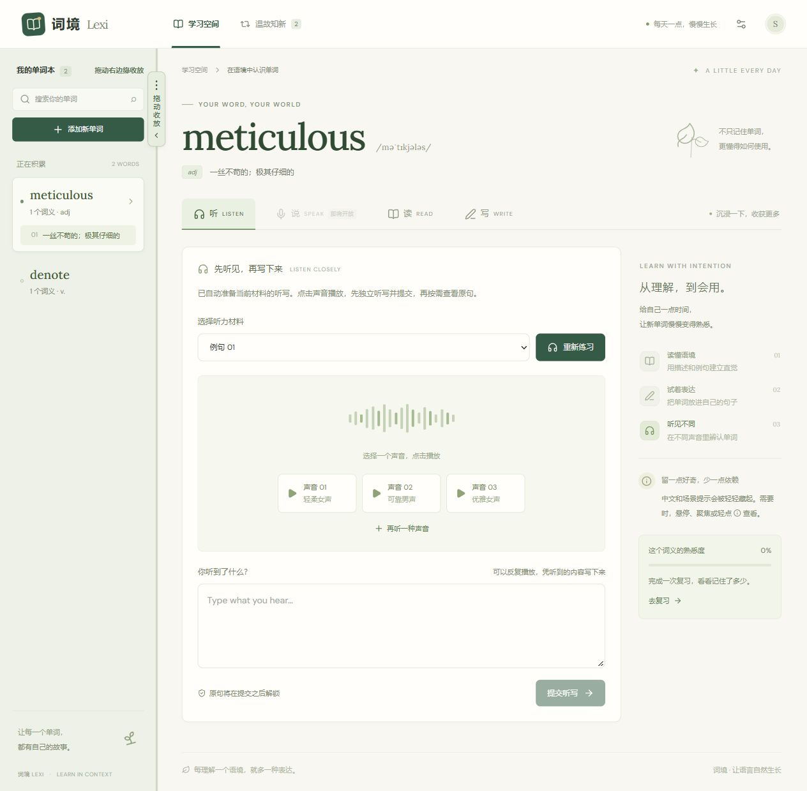
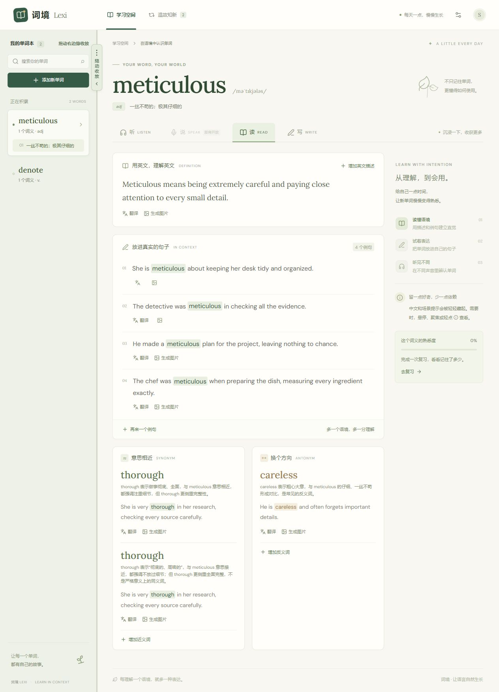
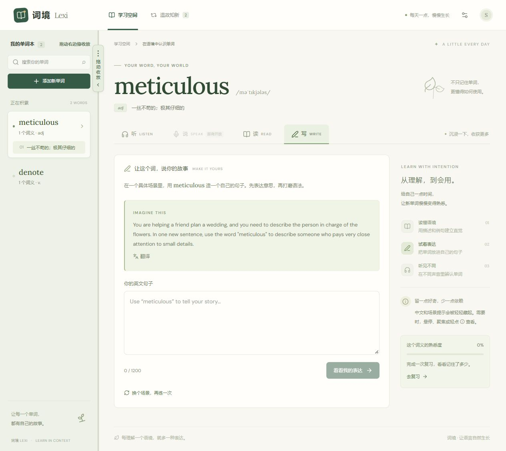
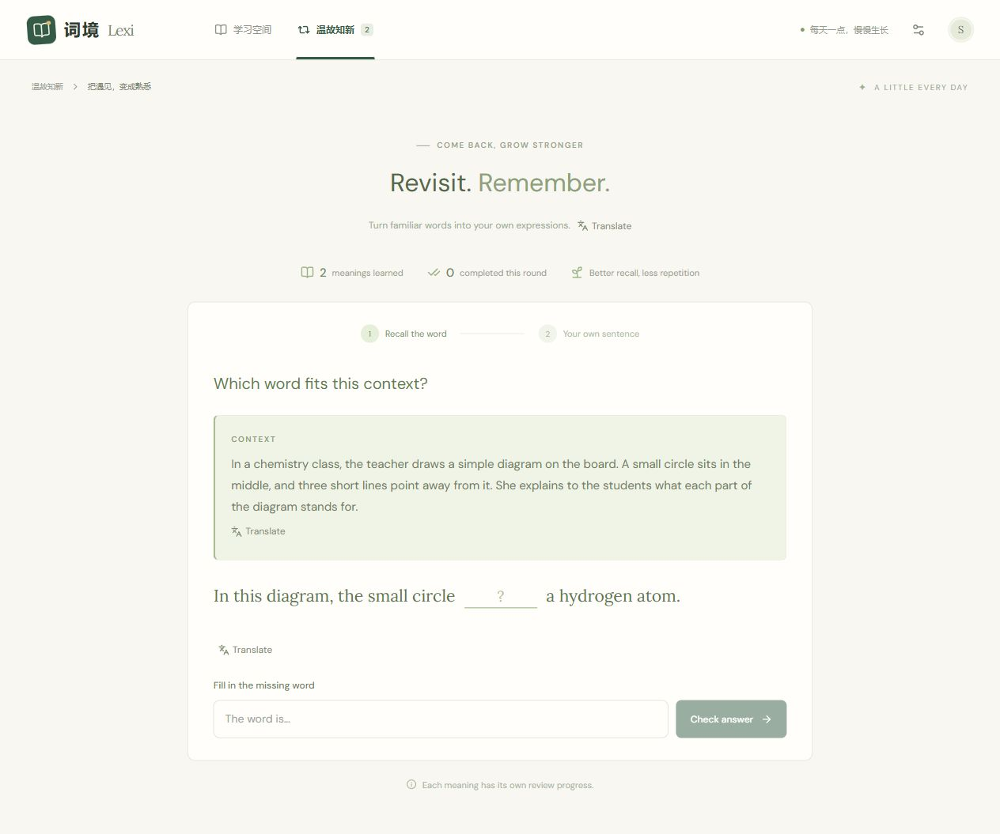
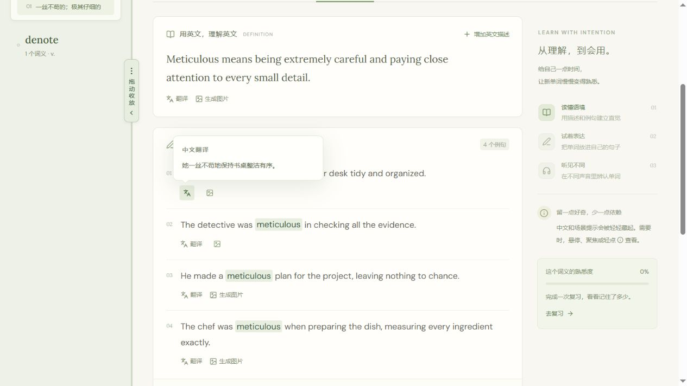
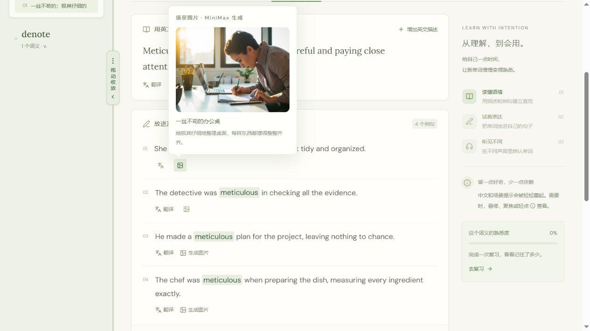

# 词境 Lexi

词境是一个在 Windows、Linux / WSL2 本地运行的英语单词学习网站。它以**单词的具体词义**为学习单位，通过阅读、场景写作、听写和复习，帮助你从“认识单词”走向“会在合适的语境里使用”。口语练习暂未开放。

## 快速开始

> 面向 **Windows、Linux / WSL2 本地使用**，不是在线托管服务。GitHub 仓库提供源码，不附带 Node.js、依赖、API 密钥或个人学习数据。

### Linux / WSL2 快速启动

安装 Linux 版 Node.js ≥ 22.13.0 和 npm，推荐将源码放到 `~/projects/lexi-english`，不要与 Windows 共用依赖或运行数据。将下方地址替换为实际仓库地址：

```bash
mkdir -p ~/projects
cd ~/projects
git clone https://github.com/<your-username>/<your-repository>.git lexi-english
cd lexi-english
npm run install:ci
cp .env.example .env  # 已有配置时不要覆盖
nano .env            # 填写 DeepSeek 和 MiniMax 密钥
npm run local:start
```

在浏览器访问启动输出的登录地址，默认为 `http://localhost:5173/signin-with-chatgpt?return_to=/`。WSL2 可使用 Windows 浏览器访问。后台服务关闭与查询：

```bash
npm run local:status
npm run local:stop
```

启动入口会自动迁移数据库并同步媒体副本；关闭终端或浏览器不会停止后台服务。WSL 关闭后需重新启动应用。详细说明见 [使用说明](使用说明.md)。

### Windows 快速启动

### 1. 获取源码与安装依赖

准备 Git、Windows x64 的 Node.js 和 npm。`package.json` 要求 Node.js ≥ 22.13.0；当前本地验证版本为 25.0.0，其他版本需自行验证。

在 PowerShell 中执行（将地址替换为本仓库实际地址；也可以通过 GitHub 的 **Code → Download ZIP** 下载并解压）：

```powershell
git clone https://github.com/<your-username>/<your-repository>.git lexi-english
Set-Location .\lexi-english
npm.cmd run install:ci

# 双击启动入口需要项目内的 runtime\node.exe
New-Item -ItemType Directory -Force .\runtime | Out-Null
Copy-Item (Get-Command node.exe).Source .\runtime\node.exe

Copy-Item .env.example .env
```

以上复制的是系统已安装的 Windows x64 Node.js。若已有 `.env`，请勿覆盖。

### 2. 填写 API 密钥

编辑项目根目录的 `.env`，将 `DEEPSEEK_API_KEY` 和 `MINIMAX_API_KEY` 替换为自己的密钥，按账户权限确认模型名称。启动脚本会检查两个密钥；调用服务会消耗相应账户额度。

### 3. 启动与关闭

双击 `启动词境.cmd`，等待初始化数据库并自动打开浏览器。默认地址为 `http://127.0.0.1:5173/`，端口占用时会自动选择其他端口，以启动窗口为准。

使用结束后双击 `关闭词境.cmd`，不要仅关闭浏览器。详细配置、备份和故障排查见 [使用说明](使用说明.md)。

## 学习流程

配置完成后，双击 `启动词境.cmd`，浏览器会自动打开；使用结束后双击 `关闭词境.cmd`。关闭浏览器不会停止后台程序。

1. **选词义**：添加英文单词，选择这次要学习的意思。同一个单词可以学习多个词义。
2. **读**：阅读英文描述、三个例句及近义词、反义词例句。可以追加材料、翻译和图片；提示默认隐藏，悬停或轻点图标查看。
3. **写**：根据英文场景造句，获得词义、语境和语法反馈。中文场景翻译需主动生成，再悬停查看。
4. **听**：进入页面自动准备三个随机音色选项，点击播放例句并听写。提交后才能悬停查看原句；可以增加音色。英文描述不参与听写。
5. **复习**：先根据英文场景填空，答对后自行选择语境造一个全新的句子。重点考核词义与使用场景，允许轻微语法错误。复习内容和反馈使用英文，提供按需翻译。

学习页左侧单词栏支持拖拽：向左拖到底收起，从左边缘向右拖展开。

## 界面预览

以下为本地运行的真实页面截图。点击图片可查看原图。

| 听 · 多音色听写 | 读 · 语境阅读 |
| --- | --- |
| [](docs/screenshots/listen.jpg) | [](docs/screenshots/read.jpg) |

| 写 · 英文场景造句 | 复习 · 语境填空 |
| --- | --- |
| [](docs/screenshots/write.jpg) | [](docs/screenshots/review.jpg) |

复习填空答对后进入自主造句，学习者自行选择使用场景。

读界面的提示默认隐藏，悬停在例句下方的对应图标上才显示。以下展示中文翻译和场景图片的提示效果，也支持聚焦或轻点图标查看。

| 读 · 悬停查看中文翻译 | 读 · 悬停查看场景图片 |
| --- | --- |
| [](docs/screenshots/read-translation.jpg) | [](docs/screenshots/read-image.jpg) |

## 工作原理

- **DeepSeek**：提供词义、学习材料、英文场景、中文翻译和造句评估，也为图片编写场景提示词。
- **MiniMax**：将例句转成不同音色的语音，并生成场景图片。音频首次播放时按需生成，后续复用已保存文件。
- **本地应用与存储**：React/Vinext 提供页面和接口，通过本地 D1/SQLite 与 R2 模拟存储保存学习记录和媒体。普通媒体副本自动导出到 `media/images`、`media/audio`，使用“单词_日期_时间_毫秒”命名。
- **复习抽样**：每个词义单独记录熟悉度。答对填空且自主造句通过后，后续抽中概率降低；失败则提高复习优先级。

网站运行在本机，但并非完全离线：生成与评估时，相关单词、练习文本或生成提示会发送给对应的模型服务商。请勿提交敏感内容。当前登录是本地模拟身份，不是真正登录 ChatGPT；学习数据不会自动同步到在线版。该身份机制不适合直接用于公网或多用户部署。

## 技术栈与目录

- **前端**：React 19、TypeScript、Tailwind CSS 4。
- **应用框架**：Vinext / Vite，采用 Next.js 风格的路由与接口。
- **数据存储**：Drizzle ORM、本地 Cloudflare D1 / R2 模拟存储。
- **模型服务**：DeepSeek 文本生成与评估、MiniMax 语音与图片生成。

```text
app/                 页面与 API 接口
components/learning/ 阅读、写作、听写、复习及共享组件
components/ui/       基础界面组件
lib/                 学习逻辑、模型调用与存储
scripts/             安装、启动、构建与媒体导出
drizzle/             数据库迁移
tests/               自动化测试
docs/screenshots/    界面截图
.env.example         环境变量样例
```

## 文档与反馈

- [部署与使用说明](使用说明.md)：详细配置、日常操作、备份恢复、开发命令与 GitHub 发布注意事项。
- 欢迎通过 Issues 反馈问题，附上复现步骤、Node.js 版本和脱敏后的错误信息；不要附带 `.env`、个人数据库或完整私人学习材料。
- 当前口语练习尚未开放；公网部署不在现有说明的覆盖范围内。Linux / WSL2 使用 npm 启停，Windows 也可使用双击入口。

仓库只保存程序、文档、配置样例和界面截图。密钥、学习数据、生成媒体、运行环境及依赖保留在本地，Git 版本记录不能替代数据备份。

## 开发检查

```bash
npm run lint
npm run typecheck
npm test
npm run build
```

测试使用本地模拟数据，不需要真实 API 密钥。`npm test` 已包含 TypeScript 和 VM Modules 所需的 Node.js 参数。GitHub Actions 会在 Windows 和 Linux 的 Node.js 22.13.0、24 环境执行上述检查。

## 许可证

本项目采用 [MIT License](LICENSE)。随仓库附带的第三方代码保留各自的许可证，见 `build/sites-vite-plugin.LICENSE` 和 `vendor/shadcn-tailwind-4.13.0.LICENSE.md`。
